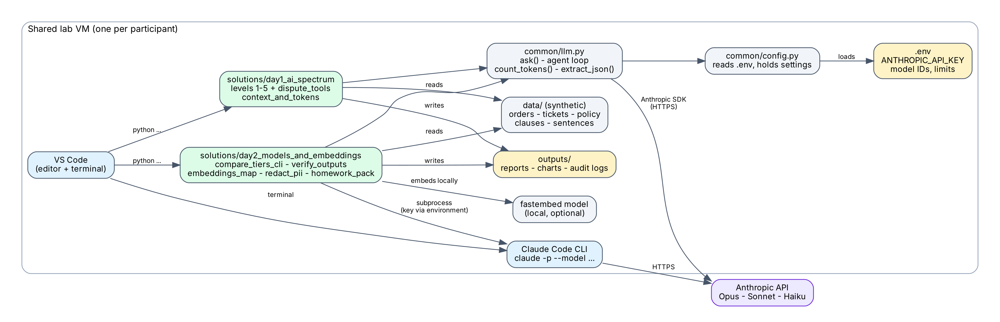
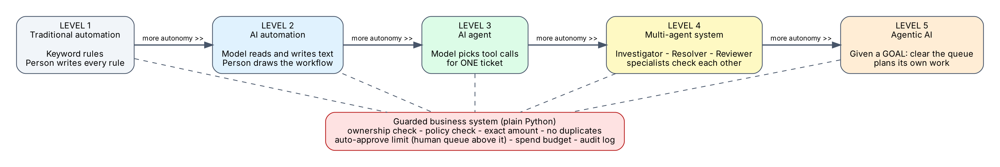
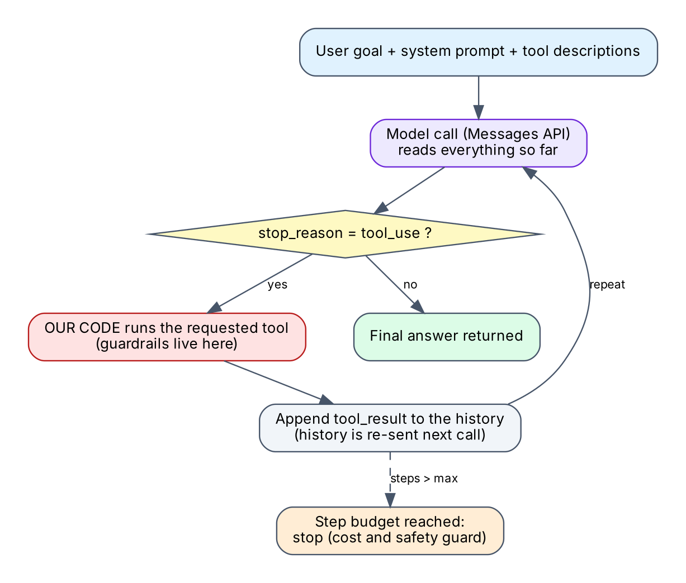
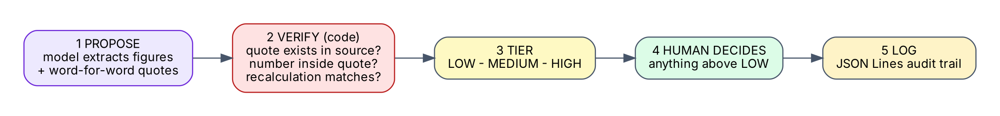
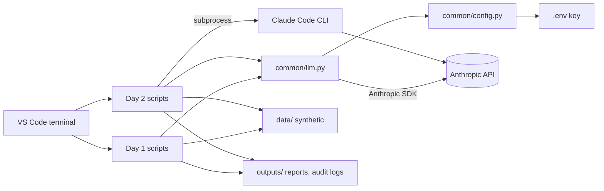

# Architecture

## Layers

| Layer | Files | Responsibility |
|---|---|---|
| Configuration | `.env`, `common/config.py` | Holds the API key, model IDs and safety limits. The `.env` path is explicit (repo root), so scripts work from any folder |
| Model access | `common/llm.py` | One small wrapper over the Anthropic SDK: `ask()`, the agent loop `run_tool_loop()`, `count_tokens()`, `extract_json()` |
| Business system | `solutions/day1_ai_spectrum/dispute_tools.py` | Plain Python: policy rules, guarded actions, audit log. No AI inside |
| Exercises | `level1..5`, `context_and_tokens.py`, Day 2 scripts | Each file teaches one idea and is runnable on its own |
| Claude Code CLI | `compare_tiers_cli.py` calls `claude -p ...` | Used for the tier comparison; the key travels in the child process environment |
| Data / output | `data/` folders, `outputs/` | Synthetic inputs; generated reports, charts and audit logs (not tracked by Git) |

## Design decisions (and why)

1. **Rules in code, language in the model.** The model can be persuaded by customer text; Python cannot. Every action that
   changes something (`issue_refund`) re-checks ownership, policy, exact amount, duplicates, approval limit and budget.
2. **The model never executes anything.** It *requests* a tool; our loop runs it. See the agent loop below.
3. **Fail safe.** Unparseable model output, an unknown tool, or an exhausted step budget leads to escalation or a stop, never to an action.
4. **Lazy client creation.** `common/llm.py` creates the SDK client on first use, so offline demos and unit tests work without a key.
5. **Explicit `.env` path.** `load_dotenv()` with no argument searches from the current folder and silently misses the file when you run from elsewhere.
6. **Testable without a network.** `tests/fakes.py` provides a scripted fake client; 55 tests run in well under a second.
7. **Tier is a dial.** Model IDs live in `.env`; Level 4 assigns a tier per role to make the cost/quality trade-off visible.

## The spectrum

## The agent loop (`common/llm.py`)

## Verification pattern (Day 2)

## Mermaid version (renders on GitHub)

